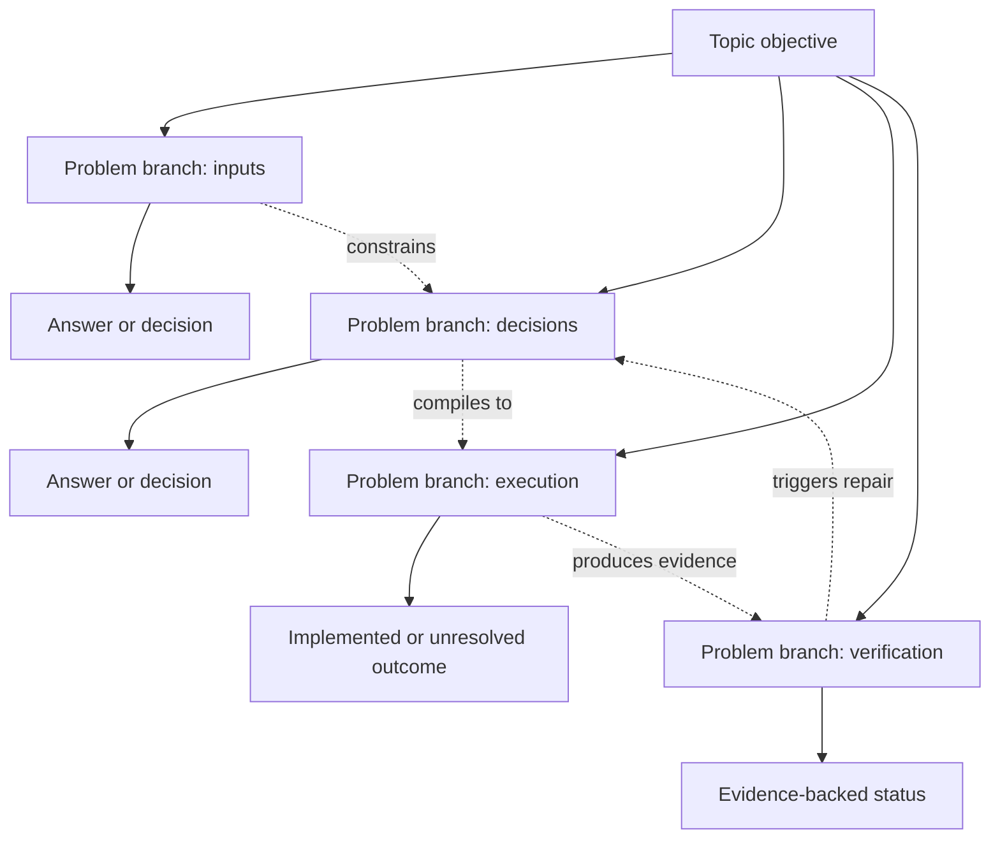

# Topic boundaries, maps, and status

Use this reference when synthesizing project topics or drawing Mermaid diagrams.

## Topic boundary

A topic is a coherent capability, decision stream, technical concern, research branch, release outcome, or operational responsibility. Keep questions together while they share the same primary outcome, object of change, and evidence owner. Start a new topic when one of those changes materially.

Summarize semantic problem nodes, not transcript order. Explain what belongs inside the topic and which adjacent questions belong elsewhere.

## Problem-map contract

- **Tree:** use when one core objective divides into independent or nested problem branches.
- **Network:** use when branches share contracts, assets, decisions, dependencies, conflicts, feedback, or recovery paths.
- **Sequence is not a problem map.** If evidence establishes a true temporal, causal, or prerequisite process, put it in a separate optional `时间线` section after the tree/network. The fact that questions were asked in order is never map evidence.

Build maps only from canonical branch references stored in source cards. The project `01-主题边界图.md` shows how its topics and branches divide or interact, has inline-JSON frontmatter `topic_node_map` mapping every `topic_key` to a unique Mermaid node ID, and must contain a real branch or merge. A topic with exactly one cited branch is a valid leaf: set `map_type: none`, omit the Mermaid problem map, and summarize its problem, answer, status, and boundary directly. A topic with two or more cited branches uses `tree` or `network` and must have at least one node whose out-degree or in-degree is two or greater. Never merge unrelated leaves merely to satisfy a diagram and never manufacture branches.

Use stable semantic node IDs and edge labels such as `细化`, `依赖`, `约束`, `产生`, `验证`, `触发修复`, `替代`, and `仍待完成`. Do not use transcript-order IDs such as `Q1`, `Q2`, and `Q3` as the organizing model.

Example network:



Each topic note contains boundary, concise answer/decision path, evidence, status, remaining work, and a map only when supported. Its frontmatter is the accounting contract:

```yaml
---
topic_key: stable-topic-key
topic: display name
status: in-progress
source_task_ids: ["provider:id"]
primary_source_task_ids: ["provider:id"]
related_source_task_ids: []
problem_branch_refs: ["provider:id#branch-key"]
task_count: 1
question_count: 2
answer_count: 2
semantic_question_count: 3
map_type: network
branch_node_map: {"provider:id#branch-key": "B1"}
first_reviewed: YYYY-MM-DD
last_reviewed: YYYY-MM-DD
---
```

`source_task_ids` is exactly the union of primary and related IDs. Each project source is primary in exactly one topic and its `primary_topic` in state equals `topic_key`; the topic keys in which it is related exactly equal state `related_topics`. Related sources do not contribute raw counts. `problem_branch_refs` resolve to cards assigned to the same project. For `tree`/`network`, `branch_node_map` has exactly those references as keys, unique Mermaid node IDs as values, and every mapped node appears in the graph. For `none`, exactly one branch is cited and `branch_node_map` is empty. Semantic count equals the cited branch roots plus their refinements.

## Status evidence ladder

Use the strongest state directly supported:

| Status | Minimum evidence |
| --- | --- |
| `discussed` | conversation analysis only |
| `planned` | accepted plan, specification, or explicit next-step decision |
| `in-progress` | implementation activity or unresolved delivery work |
| `implemented-locally` | current accessible files or commits implement the capability |
| `tested` | relevant tests were actually run and passed, or equivalent verified evidence exists |
| `released` | a release/deployment record supports delivery; this is not current production proof |
| `production-verified` | current runtime, manifest, health, or real-path evidence directly verifies production |
| `blocked` | a concrete external or technical condition prevents progress |
| `superseded` | a later recorded decision or implementation replaces it |
| `unknown` | evidence cannot support a stronger state |

A plan is not implementation. Code is not a passed test. A tag is not current production. Do not average branch states: summarize the project using the weakest state among its critical open delivery conditions, and explain stronger completed branches separately.

## Counts in maps

Semantic-question nodes can exceed raw user turns when one turn contains several distinct problems. Repeated questions collapse when they share the same outcome/object/owner. Store stable branch keys in source cards so later updates extend the map instead of redrawing it from scratch.
